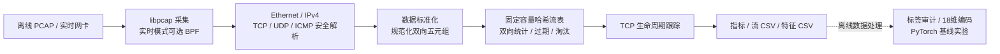

# netflow-analyzer

一个运行在 Linux/ARM64 上的 C11 网络流分析服务。

从离线 PCAP 或实时网卡读取数据，安全解析 Ethernet、IPv4、TCP、UDP、ICMP，按双向流统计包数、字节数和 TCP 连接状态，导出流记录与模型特征。已部署到鲁班猫 LubanCat-2N，并通过独立 BMS 网关与 STM32、Windows Qt 完成真实 TCP 联动。

## 已完成与实测结果

| 验证项 | 已记录结果 |
| --- | --- |
| 当前主机测试 | x86_64 Debug **51/51 项 CTest 通过**，启用 SQLite 与可选 PyTorch 测试 |
| ARM64 回归 | LubanCat-2N 完整 **37/37 项**通过；这是 2026-10-12 的板端基线，不是当前全部 51 项 |
| 网卡受控负载 | 128 条流、约 **9 Kpps**，发送约 10 分钟，处理 **540 万包**，捕获与接口两个 drop 指标均为 0 |
| 真实设备通信 | STM32 ↔ Linux 网关 ↔ Windows Qt；捕获 **2041 个 TCP 包**，实时统计与 PCAP 离线流 CSV 一致 |
| 模型部署一致性 | 既有 **63775 条 TCP 候选**在 ARM64 分批推理，分类与 PC 逐条一致；不是检测准确率 100% |
| 最小权限部署 | 分析器以专用非 root 用户运行，systemd 仅授予 **CAP_NET_RAW** |

硬件：**LubanCat-2N / RK3568 / 四核 Cortex-A55 / 2 GB 内存 / 8 GB eMMC**。受控负载不是吞吐上限测试，捕获 drop 为 0 也不等于 TCP 网络无丢包。原始方法与限制见[多流与长稳基线](docs/multiflow_longrun_baseline.md)、[ARM64 测试验收](docs/arm64_test_validation.md)、[模型部署记录](docs/tcp_arm64_inference.md)。

状态核对日期：2026-11-05。程序版本号仍为 `0.2.0`，后续开发能力按当前源码及验收记录说明，不将计划写成已实现。

## 项目架构



| 模块 | 当前能力 |
| --- | --- |
| 抓包与协议解析 | 离线 PCAP、实时网卡、BPF；以实际捕获长度检查边界，区分完整、截断、畸形、不支持和流表拒绝 |
| 双向流管理 | 规范化五元组、FNV-1a 哈希、256 槽开放寻址表、方向计数与删除标记；满表拒绝或按 last_seen 淘汰最旧流 |
| TCP 状态 | 旁路观察握手、中途捕获、FIN 关闭和 RST；不是内核 socket 状态，也不做 TCP 字节流重组 |
| 运行与输出 | 非阻塞 libpcap + poll、SIGINT/SIGTERM 收尾、静默周期指标、流记录与版本化特征 CSV |
| 边缘部署 | ARM64 原生构建、两条交叉编译链、ABI/依赖检查、非 root systemd 部署 |
| BMS 网关 | 独立 C11/POSIX 应用，串口完整行转 TCP；默认只读，显式启用后支持白名单控制 |
| BMS 数据存储 | 16 字段解析、SQLite 批量事务、历史日志导入、有界队列、专属存储线程；**尚未接入实时网关** |

网络分析主链不依赖 Python、PyTorch 或 SQLite。BMS 网关不嵌入分析器，分析器也不负责电池保护或 MOS 控制。

## 5 分钟快速开始

以下命令在 Linux 开发机的项目根目录执行。需要准备自己的 Ethernet/IPv4 PCAP；`/path/to/input.pcap` 是占位路径。

### 安装基础环境

```bash
sudo apt update
sudo apt install build-essential cmake pkg-config libpcap-dev python3
```

要求支持 C11 的编译器及 CMake 3.16+。Python 用于测试，正式网络分析程序不需要 Python 运行时。

### 构建

```bash
cmake -S . -B build -DCMAKE_BUILD_TYPE=Debug
cmake --build build -j2
```

主程序为 `build/bin/netflow-analyzer`，网关为 `build/bin/bms-gateway`。不要使用 `sudo cmake`；已有构建目录应继续使用原生成器，不强行切换 Make/Ninja。

### 运行测试

```bash
cmake -E chdir build ctest --output-on-failure
```

测试数量取决于 SQLite 和 ML 开关；上面的基础配置不保证注册全部 51 项。自动化测试使用合成数据、临时文件、管道、伪终端和本机 TCP，不需要公开数据集或真实 STM32。

### 读取 PCAP 并导出

```bash
NFA_DEMO_DIR="$(mktemp -d /tmp/nfa-demo.XXXXXX)"

./build/bin/netflow-analyzer \
    --read /path/to/input.pcap \
    --csv "$NFA_DEMO_DIR/flows.csv" \
    --feature-csv "$NFA_DEMO_DIR/features.csv"
```

两个 CSV 必须使用不同路径，且都拒绝覆盖已有文件。离线模式无需抓包特权。

### 实时抓包

终端 A：只抓回环接口上的 IPv4 ICMP，最多 4 包，外层提供 20 秒等待保护。

```bash
sudo timeout --preserve-status --signal=INT --kill-after=5s 20s \
    ./build/bin/netflow-analyzer \
    --interface lo --count 4 --filter "icmp"
```

看到抓包接口和过滤器信息后，在终端 B 产生流量：

```bash
ping -4 -c 2 127.0.0.1
```

达到包数后提前结束；没有足够匹配包时，外层超时发送 SIGINT。直接运行分析器时也可用 Ctrl+C 正常收尾。**`--count` 限制包数，不限制等待时间。** 查看全部入口：

```bash
./build/bin/netflow-analyzer --help
./build/bin/bms-gateway --help
```

## STM32、Linux 网关与 Qt 联动

已验证链路：

```text
STM32F103ZET6（采集、保护、MOS控制）
    ↕ 板载 CH340 / USB TO UART，115200 / 8N1 / 无流控
LubanCat-2N：bms-gateway（串口与TCP之间的应用层网关）
    ↕ TCP/IP
Windows：Qt 上位机（遥测展示及显式控制）

LubanCat 以太网
    ├─ tcpdump 保存 PCAP
    └─ netflow-analyzer 旁路分析双向流量与 TCP 状态
```

STM32 固件和 Qt 源码属于独立的 [stm32-bms-prototype](https://github.com/Devi1Fairy/stm32-bms-prototype) 项目；本仓库的 `gateway/` 保存 Linux 网关代码。采样、保护和 MOS 控制始终由 MCU 本地执行。

### 网关接口与安全边界

当前 CLI 格式：

```text
bms-gateway SERIAL IPV4 PORT [SECONDS] [--control]
```

- 运行预算为 1～300 秒，默认 30 秒，等待客户端也计时；端口 0 保留给软件测试。
- 当前为**单客户端、单会话**：Qt 接入后才打开串口，客户端断开后结束，不自动重连。
- 默认只读；只有末尾显式提供 `--control`，且串口配置成功后，才发送 `GW 2 CONTROL\n`。
- 遥测保留原始正文，以单个 LF 分帧。控制请求解析后只映射 `STOP→T`、`START→S`、`CLEAR→C`，不透传 TCP 原文到 UART。
- 合法请求编号为 1～4294967295，会话内严格递增；请求正文最多 64 字节，待写控制队列最多 8 项、1000ms 过期，STOP 可取消尚未写入的 START/CLEAR。
- `ACK <编号> UART_ACCEPTED` 只表示串口驱动接受了一个字节，不代表 MCU 已执行；结果仍需观察后续 BMS 状态。
- 保留 DTR=0、RTS=0、HUPCL=0 的已验证配置和关闭行为，不发送隐式控制动作。
- 实物接入前核对串口身份、当前会话权限与占用，避免第二个进程争抢串口；开口、转发和退出后都要观察 MCU 心跳。板载 USB TO UART 同时供电，拔线不能当作单纯的通信断连。

真实设备联调已由用户确认启动、停止、清除故障可用；这不等于已完成真实电池充放电、故障注入或产品级保护验证。首次接线、权限和运行前检查见[交接文档第18节](docs/session_handoff.md)。

### 真实 TCP 流量验收

2026-11-04 在板端 `eth0` / Ethernet 上，先启动捕获，再连接 Qt；该次 BPF 为：

```text
tcp and host 192.168.1.100 and port 18080
```

这是历史实验地址，不是新部署的默认配置。再次运行前须核对实际接口、地址、串口身份、权限与占用，不用额外 TCP 探测抢占网关会话。

| 方向 | 端点 | 包数 | 捕获字节 / 原始记录字节 |
| --- | --- | ---: | ---: |
| A → B | Windows 192.168.1.100:30502 → 网关 192.168.1.102:18080 | 1021 | 61272 / 61272 |
| B → A | 网关 → Windows | 1020 | 233958 / 233958 |

合计 2041 包、1 条观察到 `closed` 的双向 TCP 流；实时汇总与同次 PCAP 导出的流 CSV 身份、状态和计数一致。该次只观察遥测，用户未点击 STOP，不将它登记为控制命令验收。

分析器不提供 `--write`；PCAP 由 tcpdump 保存，再使用 `--read` / `--csv` 回放。分析器不打开 UART、不作为网关的 TCP 客户端，也不解析或重组 TCP 中的 BMS 消息。完整命令、SHA-256 和统计限制见[交接文档第18.14.6节](docs/session_handoff.md)。

## BMS SQLite：已实现组件，实时接入待完成

当前代码已具备：

- 严格解析 16 个 BMS 遥测字段，拒绝缺失、重复、未知字段及整数越界。
- SQLite 预编译参数绑定、每批最多 128 条、事务失败回滚。
- 历史日志导入 CLI：拒绝覆盖目标数据库，成功后发布新文件。
- 最多 256 项的按值队列；满、锁忙和关闭分别返回明确错误。
- 专属存储线程：自己打开、写入和关闭 SQLite；按批量或单调时钟期限提交，关闭队列后提交尾批，并报告结果。

**尚未实现实时网关接入。** 当前 `bms-gateway` 没有数据库参数，也没有“Qt 离线仍采集”的运行模式。新的完整行采集生产者仅为待录入方案，不计入已提交能力或第 52 项测试。

### 启用 SQLite 组件

```bash
sudo apt install libsqlite3-dev sqlite3

cmake -S . -B build -DNFA_ENABLE_BMS_SQLITE=ON
cmake --build build -j2

cmake -E chdir build ctest \
    -R '^bms_(telemetry|store|sample_queue|store_worker|import)_tests$' \
    --output-on-failure
```

历史日志导入示例（需替换输入路径）：

```bash
NFA_DB_DEMO_DIR="$(mktemp -d /tmp/nfa-bms-import.XXXXXX)"

./build/bin/bms-import \
    /path/to/receive.txt \
    "$NFA_DB_DEMO_DIR/bms.sqlite3" \
    demo-device historical-run-01
```

输入只接受不超过 16 MiB 的普通日志文件及完整 LF/CRLF 行；历史接收时间未知时明确写 `received_unix_us=0`，不伪造为导入时间。已在 VM 从真实历史日志读回 **118 条记录**；这不是板端实时入库验收。

入队成功不等于数据库提交；存储失败不自动重试或补传。SD 卡数据库的文件系统锁、容量、介质故障和掉电恢复仍待专项验证，不能把组件测试通过解释为这些问题已解决。

## 本地 AI 实验及其与 AI 应用开发的关联

这里的 AI 是**离线监督二分类与端侧推理实验**，不是已上线的异常预警或大模型网络分析系统。

```text
公开 PCAP → 同一 C 特征提取器 → 流/特征 CSV
→ 标签身份、生命周期边界与跨流复用审计
→ 按来源划分数据 → 18维 TCP 输入 → 训练侧预处理
→ PyTorch 线性二分类 → 模型/预处理参数保存 → ARM64 推理对照
```

训练使用 IoT-23 Scenario 3-1 的 57767 条候选，验证使用 Scenario 8-1 的 6008 条候选。18 维由 9 项数值与 9 类 TCP 阶段独热编码组成；IP、端口、来源和标签不作为输入，预处理只在训练集合拟合。

63775 条既有候选在鲁班猫分批推理，与 PC 分类逐条一致，最大 logit 绝对差约 `1.91e-6`。这证明部署一致性，**不证明检测效果达标**：

- 验证集只有 2 条正常 TCP，6008 条全部判恶意，平衡准确率为 0.5。
- Scenario 42-1 的 1440 条正常候选诊断中，444 条误报，误报率约 30.83%；该来源已被查看，不是最终盲测集。
- 输入特征存在跨来源同向量异标签问题；不能仅凭训练分数或增加网络深度声称解决。
- 尚未接入实时告警，也未实现机器学习异常检测。

工程价值在于数据采集、数据预处理、状态管理、可靠性测试、可观测性和边缘部署。这些是 AI 应用落地所需的基础能力，但项目本身不等同于训练大型模型或实现成熟检测产品。

详见[训练基线](docs/tcp_linear_baseline.md)、[正常流误报诊断](docs/tcp_normal_diagnostic.md)、[候选来源记录](docs/iot23_pilot_provenance.md)与[ARM64 推理验收](docs/tcp_arm64_inference.md)。

### 可选 ML 测试

网络分析与 BMS 基础功能不要求安装 PyTorch。开发机如需运行 ML 测试，可在独立环境安装本仓库记录的依赖：

```bash
sudo apt install python3-venv
python3 -m venv .venv
.venv/bin/python -m pip install -r requirements-ml.txt

cmake -S . -B build \
    -DNFA_ML_PYTHON_EXECUTABLE:FILEPATH="$PWD/.venv/bin/python"

cmake --build build -j2
cmake -E chdir build ctest --output-on-failure
```

当前 51 项计数需要**同时启用 SQLite 和 ML**。未配置 `NFA_ML_PYTHON_EXECUTABLE` 时不会注册 4 项 PyTorch 测试；SQLite 默认为 OFF。板端 Python 3.8 的兼容环境与开发机不同，不应直接照搬此依赖文件，按[ARM64 测试手册](docs/arm64_test_validation.md)准备。

## 命令与数据契约

### 分析器参数

| 参数 | 作用与限制 |
| --- | --- |
| `--help` / `--version` | 查看当前二进制接口与版本 |
| `--read FILE` | 分析离线 Ethernet PCAP |
| `--interface NAME` | 实时抓取指定接口；需要相应抓包权限 |
| `--count N` | 正整数实时处理包数上限；省略则运行到停止信号 |
| `--filter EXPR` | 实时 BPF 过滤；含空格时加引号 |
| `--flow-full-policy reject\|evict-oldest` | 实时满表拒绝新流，或淘汰最旧流 |
| `--flow-idle-timeout SECONDS` | 仅离线模式，按正整数秒空闲分段；省略时保持整文件聚合 |
| `--csv FILE` | 离线导出完整流记录；不覆盖已有文件 |
| `--feature-csv FILE` | 导出版本化流特征；实时模式必须同时提供 `--count` |

短参数：`-h`、`-V`、`-r`、`-i`、`-c`。普通 CSV 与特征 CSV 可以在同一次离线运行生成，但路径不能相同。

### 流 CSV 与特征 CSV

流 CSV 保留 `protocol`、`tcp_state`、`endpoint_a_ip`、`endpoint_a_port`、`endpoint_b_ip`、`endpoint_b_port`；两个方向分别使用 `a_to_b_*` 与 `b_to_a_*` 的包数/捕获字节/原始记录字节列，时间使用 `first_seen_seconds`、`first_seen_microseconds`、`last_seen_seconds`、`last_seen_microseconds`。A/B 来自端点规范化排序，不保证 A 总是连接发起方。

`captured` 累计实际 `caplen`，`wire` 累计 PCAP 记录的原始包长，均不是 TCP 应用正文长度，也不额外补算捕获记录没有提供的物理开销。

特征文件模式为 `flow_features_v1`：

| 列名 | 含义 |
| --- | --- |
| `schema_version` | 格式版本，不作为模型输入 |
| `protocol` | IPv4 上层协议号：ICMP 1、TCP 6、UDP 17 |
| `duration_microseconds` | 首末包时间差，微秒 |
| `total_packet_count` | 双向包数 |
| `total_captured_byte_count` | 双向实际捕获字节 |
| `total_wire_byte_count` | 双向原始记录字节 |
| `mean_captured_bytes_per_packet` | 平均捕获包长 |
| `mean_wire_bytes_per_packet` | 平均原始记录包长 |
| `packet_count_imbalance_ratio` | 方向包数不平衡度，0～1 |
| `wire_byte_count_imbalance_ratio` | 方向字节不平衡度，0～1 |
| `tcp_state_applicable` | TCP 状态是否适用 |
| `tcp_phase` | 旁路观察的 TCP 阶段 |
| `tcp_handshake_completed` | 是否观察到完整握手 |

TCP 阶段包括 `unobserved`、`syn-seen`、`syn-ack-seen`、`established`、`midstream`、`fin-seen`、`fin-bidirectional`、`closed`、`reset`；非 TCP 写为 `not-applicable`。

同次有限实时采集中，特征来自过期、容量淘汰和退出时仍活动的三组互斥记录。身份和标签通过独立 sidecar 连接，不混入特征。关联时必须使用同一次分析的流/特征文件、相同行号与生命周期配置；唯一匹配还需检查标签复用及时间边界，不能按行号直接给任意 CSV 贴标签。

### 指标口径

- 周期指标按 `CLOCK_MONOTONIC` 约每 5 秒输出；无匹配包也报告零流量。
- 实时流过期按包时间高水位推进，固定空闲 30 秒、每 5 秒事件时间扫描；完全静默时等下一包触发，不是后台定时删流。
- `Processing results` 的五类互斥；`flow_rejected` 统计被拒绝的数据包，不是不同流的数量。
- `pcap_stats` 与应用处理计数属于不同层级，不能用 received 减 total 计算网络丢包；TCP 包数也不等于 BMS 报告条数。

## 部署与技术边界

已完成两条 ARM64 交叉构建链：官方 Buildroot SDK，以及通用 GCC + 板端 sysroot。交付前需检查架构、动态依赖、GLIBC 要求与 SHA-256，不能仅凭相同的 `0.2.0` 版本字符串认定产物相同。

分析器的 systemd 模板位于 `packaging/systemd/`，使用专用用户、`CAP_NET_RAW`、`NoNewPrivileges` 及文件系统等限制；参数来自 `/etc/default/netflow-analyzer`，日志进入 journal。**该模板不是 BMS 网关或 SQLite 的服务部署。**

- 当前分析主链支持 Ethernet II 和 IPv4，不支持 VLAN、IPv6、隧道、IP 分片重组、TCP 乱序/字节流重组或校验和验证。
- DNS 仅实现并测试了独立的 12 字节固定头解析，未接入采集主链，不包含域名压缩、资源记录、DNS 事务匹配或完整 DPI。
- 流表固定 256 槽，有删除标记与满表策略，没有动态扩容。`evict-oldest` 使用一次满表扫描完成最旧流选择和替换；300 新流测试中探测操作由 344 降到 300，不是所有场景的耗时下降比例。
- 抓包分析主链仍是单线程；新增 pthread 队列/线程用于独立 BMS 存储组件，不能写成已完成多线程抓包流水线。
- Netflow 是项目名称；当前未实现 NetFlow/IPFIX 导出协议。
- eMMC 空间有限，源码与可执行文件保留在 Linux 文件系统；板端数据卡为 VFAT/`noexec`，不能照搬 venv 或构建树。长期日志、数据容量和 SQLite 掉电可靠性需要分别管理与验证。
- 不提供自动阻断、网络攻击确认或在线告警；不以本项目软件代替真实电池安全保护验证。

部署步骤见[交叉编译](docs/cross_compilation.md)与[非 root systemd 部署](docs/systemd_deployment.md)，故障处理见[问题记录](docs/problem_log.md)。

## 目录与资料导航

```text
include/analyzer/      网络分析核心的公开接口
src/                   抓包、协议、双向流、TCP状态、指标及CSV
gateway/               独立BMS串口/TCP网关、控制协议、SQLite组件
scripts/               标签审计、候选数据、特征预处理及模型实验
tests/unit/            C单元与组件测试
tests/integration/     CLI、PTY/TCP、数据契约及ML测试
packaging/systemd/     分析器服务和默认参数模板
docs/                  部署、测量、故障、数据与验收记录
labs/                  独立实验，不代表正式主链已集成
```

`build*/` 为生成目录。原始 PCAP、数据库、模型和板端运行日志保留在仓库外，不提交敏感通信数据或大体积产物。

| 想了解的内容 | 文档 |
| --- | --- |
| 单流性能与测量方法 | [performance_baseline.md](docs/performance_baseline.md) |
| 多流容量与540万包长稳 | [multiflow_longrun_baseline.md](docs/multiflow_longrun_baseline.md) |
| ARM64工具链与服务部署 | [cross_compilation.md](docs/cross_compilation.md)、[systemd_deployment.md](docs/systemd_deployment.md) |
| 板端完整37项测试 | [arm64_test_validation.md](docs/arm64_test_validation.md) |
| 数据来源、模型与误报限制 | [iot23_pilot_provenance.md](docs/iot23_pilot_provenance.md)、[tcp_linear_baseline.md](docs/tcp_linear_baseline.md)、[tcp_normal_diagnostic.md](docs/tcp_normal_diagnostic.md) |
| 模型在鲁班猫的推理一致性 | [tcp_arm64_inference.md](docs/tcp_arm64_inference.md) |
| BMS实物联动、抓包和SQLite阶段 | [session_handoff.md 第18节](docs/session_handoff.md) |
| 其他本地LLM部署试验及质量限制 | [local_llm_deployment.md](docs/local_llm_deployment.md) |
| 实际故障与技术取舍 | [problem_log.md](docs/problem_log.md)、[technical_decisions.md](docs/technical_decisions.md) |

## 后续路线

1. 将采集生产者、独立存储线程与 TCP 会话接入显式新网关模式，保留旧只读/控制 CLI；先做 PTY 与本机网络回归，再安排实物验收。
2. 验证 Qt 离线持续采集、断连不清采集队列、重新接入及慢客户端处理，明确存储背压和故障上报。
3. 对板端 SQLite 数据盘做容量、锁竞争、介质故障与安全收尾验证，再考虑轮转、备份和长期服务。
4. 在有需求和证据支持时扩展主机/时间窗行为特征、DNS解析或流表容量；规则检测、机器学习异常检测与实时预警仍属后续路线。

## 版本沿革

- `v0.0.1`：可构建、可运行、可测试的工程骨架。
- `v0.1.0`：离线 PCAP → 安全协议解析 → 双向流聚合。
- `v0.2.0`：增加哈希流表、过期、CSV、实时抓包与 BPF。
- 后续 `Unreleased`：信号收尾、周期指标、TCP状态、版本化特征、ARM64部署、本地模型实验、BMS联动及可选SQLite组件；完成度以各模块代码及上述验收为准。

完整阶段记录见 [CHANGELOG.md](CHANGELOG.md) 与 [技术决策](docs/technical_decisions.md)。
